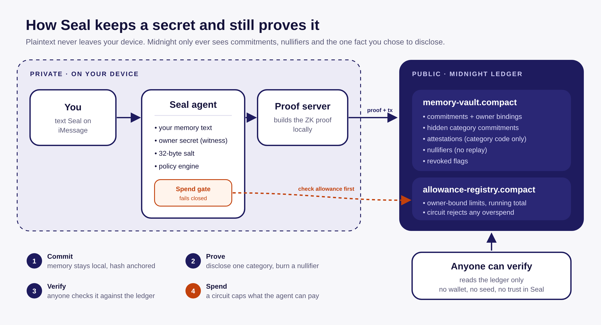

<p align="center">
  <picture>
    <source media="(prefers-color-scheme: dark)" srcset="docs/assets/brand/seal/seal-lockup-dark.png">
    
  </picture>
</p>

<p align="center"><b>Seal</b> is a privacy-first personal agent. You text it. It remembers for you, and it can prove
things about those memories on <a href="https://midnight.network/">Midnight</a> without ever revealing them.</p>

<p align="center">Built for the <b>Akindo Wave Hacks buildathon</b> (Midnight track) on top of
<a href="https://github.com/mariagorskikh/open-instinct">Open Instinct</a>.<br>
Submission brief: <a href="docs/SUBMISSION.md">docs/SUBMISSION.md</a>.</p>

## What Seal adds to Open Instinct

The base project is a real personal agent you text on iMessage. This fork gives it a
shielded memory vault and a spend limit that a circuit enforces.

| New here | Where |
|---|---|
| `memory-vault` and `allowance-registry`, two Compact contracts | `contracts/` |
| The agent's Midnight client, tools and private state | `packages/midnight/` |
| Verifier path: `POST /verify`, `GET /verify/<id>`, `instinct midnight verify` | `deploy/midnight-devnet/`, `packages/cli` |
| Allowance gate checked before every gated action, failing closed | `packages/core/src/runtime.ts`, `packages/server/` |
| The Preprod sync fix: one dropped indexer socket used to be fatal | `deploy/midnight-devnet/scripts/patch-wallet-sdk.mjs` |

Commits: `d727522` (vault), `99d2172` (verifier and gate), `8d6a61f` (sync fix), `88ceffe` (model gateway).
Full authorship and evidence: [docs/SUBMISSION.md](docs/SUBMISSION.md).

## Two ledgers

The whole design is a split between what the world can read and what stays on your machine.

<p align="center"></p>

| Public (Midnight, Preprod) | Private (your host) |
|---|---|
| 32-byte commitments to each memory | the memory text itself, in `MEMORY.md` for the owner and `memory/people/<hash>/MEMORY.md` for anyone else the agent talks to |
| category attestations, one code per proof | the plain category code, until the owner attests it |
| single-use nullifiers | the owner secret and salts |
| allowance limits, spends and revocations | which purchase a spend was for |

A verifier learns one bit of meaning (the category you chose to disclose) and that the
proof has not been used before. It learns nothing else, and needs no wallet, no seed and no
cooperation from the agent.

## Judge path

Deployed and exercised on Preprod (public testnet) on 2026-10-16:

| Contract | Address |
|---|---|
| `memory-vault` | `6e9d608a997d5642564cbaea2b0a93a45fae0b806ee5fb68e8e0b008c2f19f7f` |
| `allowance-registry` | `fd4bfac0d1ae522793050401ee9021bc7dfe27767745f5a3e954d15895d4afb1` |

### Text the live agent

The agent is deployed from this repository: it runs on a VM with no laptop
attached, reachable over iMessage and email. Text `connect @sealai` to
**+16504849720**, or email `sealai@inkboxmail.com`, then:

1. Tell it your name and ask it to remember something. Each person who texts it gets a
   notebook of their own on the host.
2. Ask it to prove a fact about that memory. The text stays on the host; the reply
   carries an attestation id and a link.
3. Open that link (`https://sealai.inkboxwire.com/verify/<attestationId>`), or paste
   the id at [`/verify`](https://sealai.inkboxwire.com/verify). No wallet, no seed,
   no cooperation from the agent: the page reports whether the attestation is
   recorded, which single category it disclosed, and that it is single-use. The same
   id also verifies from the CLI: `instinct midnight verify <attestationId>`.

The live agent anchors in `mock` mode, and every page it serves says so: the
commitment and the nullifier are real, no transaction was submitted. The on-chain
evidence is the recorded Preprod run below, with the contracts, the attestation and
the verifier transcript.

The VM sleeps when idle, so a message can land while it is asleep. Every delivery
is logged and replayable (`inkbox webhook delivery list`, then
`inkbox webhook delivery replay <delivery-id>`), so no message is lost.

The same sleep applies to the proof page, which the agent itself serves: while the VM
is asleep `https://sealai.inkboxwire.com/verify` does not connect at all (and it answers
`200` within seconds of a wake), so wake the agent with one message before showing the
link. The recorded Preprod transcript below is unaffected: it is a captured read.

### Straight from a fresh clone

Three commands, no keys and no wallet:

```bash
pnpm install && pnpm build
node examples/midnight-demo.mjs                 # commit, prove, verify offline: deterministic, no chain
pnpm --filter @open-instinct/midnight run test  # the layer's own suite
```

To verify the real Preprod attestation, run the read-only adapter against Preprod and ask it:

```bash
cd deploy/midnight-devnet && npm run adapter -- --network preprod   # needs BLOCKFROST_PROJECT_ID
instinct midnight verify c91ebd08d0010b1a1aac921345ba5fe69354b87e910d346dd753573e7d352145
```

```
Verified — valid health proof (single-use, cannot be replayed)
  disclosed: health (code 1)
  single-use: yes (cannot be replayed)
  public URL: http://127.0.0.1:6400/verify/c91ebd08d0010b1a1aac921345ba5fe69354b87e910d346dd753573e7d352145
```

An unknown id returns `valid: false` and a malformed one is rejected with a reason, so this is
not a function that returns true. The allowance side refuses too: after `$20` of a `$50`
allowance was spent, a further `$40` came back `failed assert: over allowance`, refused by the
circuit rather than by the agent's code. Both transcripts are in
[SUBMISSION.md](docs/SUBMISSION.md).

## How this differs from a budget-proving agent

A budget agent proves one thing: that a number stayed under another number. Seal keeps the
agent's **whole memory** private, proves facts about any of it on demand, and gates spending
with the same machinery.

---

## What is new in this fork

This fork is judged on work that is new to it, so here is the line between the two, with the
commit date for each piece. Everything below was written for the buildathon, after the base's
last commit on 2026-10-05.

| New in this fork | Path | First commit | Date |
|---|---|---|---|
| `memory-vault`: opaque commitments, category-only attestations, single-use nullifiers | `contracts/memory-vault.compact` | `83486c0` | 2026-10-09 |
| `allowance-registry`: owner-bound spend limits enforced in-circuit | `contracts/allowance-registry.compact` | `2b180db` | 2026-10-10 |
| The agent's Midnight client, private-state plumbing and tools | `packages/midnight/` | `83486c0` | 2026-10-09 |
| Proof-server adapter: `/verify`, `/allowance/*`, the wallet console | `deploy/midnight-devnet/src/adapter.ts` | `83486c0` | 2026-10-09 |
| Verifier path that needs no wallet: `instinct midnight verify <id>` | `packages/cli/src/commands/midnight.ts` | `99d2172` | 2026-10-14 |
| Allowance gate: the circuit, plus a fail-closed runtime check before every gated action | `packages/core/src/runtime.ts`, `packages/core/src/policy.ts` | `99d2172` | 2026-10-14 |
| Preprod sync fix: reconnect, progress logging and checkpoints that make a 17-hour sync resumable | `deploy/midnight-devnet/scripts/patch-wallet-sdk.mjs` | `8d6a61f` | 2026-10-14 |
| The LLM API gateway as a first-class model provider | `packages/core/src/model.ts` | `88ceffe` | 2026-10-15 |

**From Open Instinct, unchanged.** The agent loop, the Inkbox identity and messaging layer, the
six trust tiers, the gateway, the memory files, the skills, the CLI and the model plumbing are
the work of Maria Gorskikh and contributors, merged through `a4df7ee` on 2026-10-05. This fork
makes no claim to them.

One honest note about iMessage: the channel itself arrives with the base's Inkbox layer. What is
new here is the live `@sealai` identity, the self-hosted tunnel and webhook path, and operating
it end to end.

`docs/SUBMISSION.md` carries the same split in more detail, including what the fork changed
inside shared files.

---

## The base project: Open Instinct

What follows documents the agent this fork builds on. It is the work of Maria Gorskikh and
contributors, and it runs unchanged unless you switch the Midnight layer on.

<p align="center">An open-source personal agent you text. It has its own computer, does real tasks, and coordinates with the agents of the people you trust.<br>A from-scratch, documented clone of <a href="docs/research/INSTINCT.md">Instinct</a>, built so anyone can run one.</p>

<p align="center"></p>

## How it works

<p align="center"></p>

You text a phone number. [Inkbox](https://inkbox.ai) gives the agent that number, an email address and an agent-to-agent endpoint. A small gateway wakes your agent, which lives in its own microVM on [Maritime](https://maritime.sh) with a Linux desktop. Inside, a [Pi](https://github.com/earendil-works/pi) agent loop runs with your apps through [Composio](https://composio.dev), a wallet through [Stripe Link](https://docs.stripe.com/agentic-commerce/agents/link-agent-wallet), and a policy guard in front of every tool. Default model: Claude Fable 5.1. Any Pi provider works.

It writes real files, too: ask for a brief "as a PDF" and it creates one in its workspace and sends it to you as an iMessage or email attachment. Any app Composio supports can be connected by name ("connect my Notion"), and the prompt it runs with is a file you can read and edit (`instinct prompt`, `instinct persona`; see [CUSTOMIZE.md](docs/CUSTOMIZE.md)).

<p align="center"></p>

## Who gets which key

<p align="center"></p>

Six tiers, enforced in code before any tool runs. Your partner's agent can read your calendar. A friend's can only ask when you are free. A stranger gets a polite no, and you get a one-line text saying who asked for what. Grants add exceptions in plain English: "Sam can book us dinner this week." Details in [PERMISSIONS.md](docs/PERMISSIONS.md) and [PROTOCOL.md](docs/PROTOCOL.md).

## Payments

<p align="center"></p>

The agent never holds your card. For each purchase it asks your Stripe Link wallet for a single-use card for the exact total, you approve with one tap, and the card is dead after the payment. Limits live in a spend policy file: ask above an amount, daily cap, and things that always need a yes. Without a wallet it still gets you to checkout and hands you the screen. Details: [PAYMENTS.md](docs/PAYMENTS.md).

## Privacy (Midnight)

The agent can keep your memories as **shielded commitments** on [Midnight](https://midnight.network/), so the chain never sees your words — only opaque 32-byte commitments. Ask it to prove something *about* a memory (that it exists, that it is a health note) and it produces a selective-disclosure proof that reveals nothing else. Spending can be gated the same way, against on-chain allowances.

```bash
pnpm run contracts:check                    # compile both Compact contracts (toolchain 0.31.1)
node examples/midnight-demo.mjs             # offline demo, no key or wallet
pnpm --filter @open-instinct/midnight run test
instinct midnight status                     # mode, contracts, anchor counts
cd deploy/midnight-devnet && npm run setup   # real local devnet deploy + commit + attest
```

Both contracts (`memory-vault`, `allowance-registry`) compile with `compact compile` 0.31.1 and use the platform's `persistentCommit`/`disclose` idioms.

Three modes: `mock` (offline, deterministic, the default), `local` (midnight-local-dev), and `testnet` (real transactions). The layer is off unless `MIDNIGHT_MODE` is set, so enabling it never changes a normal boot. Details: [MIDNIGHT.md](docs/MIDNIGHT.md) and [ARCH-MIDNIGHT.md](docs/ARCH-MIDNIGHT.md).

## Quick start

Node 22.19+ and pnpm 10. You bring your own keys; [KEYS.md](docs/KEYS.md) lists which ones and how to get them. No key is stored in this repository.

**On your laptop, no phone number yet**

```bash
git clone https://github.com/tobi-techy/midnight-instinct && cd midnight-instinct
nvm use && corepack enable        # if corepack needs permissions: npm install -g pnpm@10
pnpm install && pnpm build
export ANTHROPIC_API_KEY=sk-ant-...
pnpm instinct init --name "Maria" --phone +14155550100 --email maria@example.com --handle maria-instinct
pnpm instinct dev                 # then, in another terminal:
pnpm instinct chat "remember that I like window seats"
```

**With an iMessage line**

```bash
export INKBOX_ADMIN_API_KEY=...   # inkbox.ai console
pnpm instinct init --name "Maria" --phone +14155550100 --email maria@example.com --handle maria-instinct
pnpm instinct dev --tunnel
pnpm instinct connect             # prints the number and the text to send: connect @maria-instinct
```

**The Instinct way: one agent per person on Maritime**

```bash
export MARITIME_API_KEY=mk_...    # maritime.sh, Settings, API keys
pnpm instinct deploy --image ghcr.io/mariagorskikh/open-instinct-agent:latest
```

For many people, run the [gateway](packages/gateway/README.md): a signup page that provisions an identity and an agent per person. Guide: [DEPLOY-MARITIME.md](docs/DEPLOY-MARITIME.md).

| The signup page | The connect page |
|---|---|
|  |  |

<p align="center"></p>

## Repository

```
packages/core       Pi agent loop, policy engine, per-person notebooks, scheduler, approvals, audit
packages/inkbox     iMessage, SMS, email, webhooks, agent-to-agent transport
packages/computer   the desktop (Maritime desktopd in the VM, or hosted Computers MCP)
packages/apps       Composio Tool Router
packages/network    contacts, tiers, grants, invitations, agent-to-agent tools
packages/payments   Stripe Link wallet: one-time cards the owner approves
packages/midnight   Midnight privacy layer: shielded memory vault, ZK proofs, ZK-gated allowances
packages/server     the agent process (/health, /chat, /schedules)
packages/gateway    multi-user relay and signup
packages/cli        the instinct command
contracts/          Compact contracts (memory-vault, allowance-registry)
skills/             playbooks the agent follows
docs/               architecture, permissions, protocol, keys, deploy, research
```

## Documentation

[Architecture](docs/ARCHITECTURE.md) · [Customize](docs/CUSTOMIZE.md) · [Permissions](docs/PERMISSIONS.md) · [Protocol](docs/PROTOCOL.md) · [Keys](docs/KEYS.md) · [Deploy on Maritime](docs/DEPLOY-MARITIME.md) · [Self-host](docs/SELF-HOST.md) · [Inkbox](docs/INKBOX.md) · [Composio](docs/COMPOSIO.md) · [Payments](docs/PAYMENTS.md) · [Midnight](docs/MIDNIGHT.md) · [Midnight architecture](docs/ARCH-MIDNIGHT.md) · [Privacy model](docs/PRIVACY-MODEL.md) · [Submission brief](docs/SUBMISSION.md) · [Security](docs/SECURITY.md) · [FAQ](docs/FAQ.md) · [Examples](examples/README.md) · Research: [What Instinct is](docs/research/INSTINCT.md), [Requirements](docs/research/REQUIREMENTS.md), [Tech reference](docs/research/TECH-REFERENCE.md)

## Status

The base is version 0.1: nine packages, an end-to-end smoke test and a cold-start test from a fresh clone. This fork adds the Midnight layer and stands at **1015 tests across 10 packages**, plus 13 Compact-runtime simulator tests. Both contracts are live on Preprod. Live iMessage and Maritime deployment were exercised against real identities during development; treat them as beta.

Merit Systems publishes an unrelated project called [OpenInstinct](https://github.com/Merit-Systems/OpenInstinct). This project is not affiliated with it or with Instinct.

## License

Apache License 2.0, see [LICENSE](LICENSE).

The base project this fork builds on, Open Instinct by Maria Gorskikh and contributors, is MIT
licensed. That notice is preserved in [LICENSE-MIT](LICENSE-MIT) so the upstream terms travel
with the code they cover.

[Contributing](CONTRIBUTING.md)
