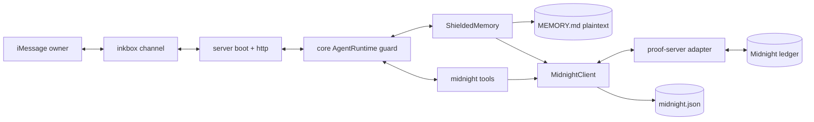
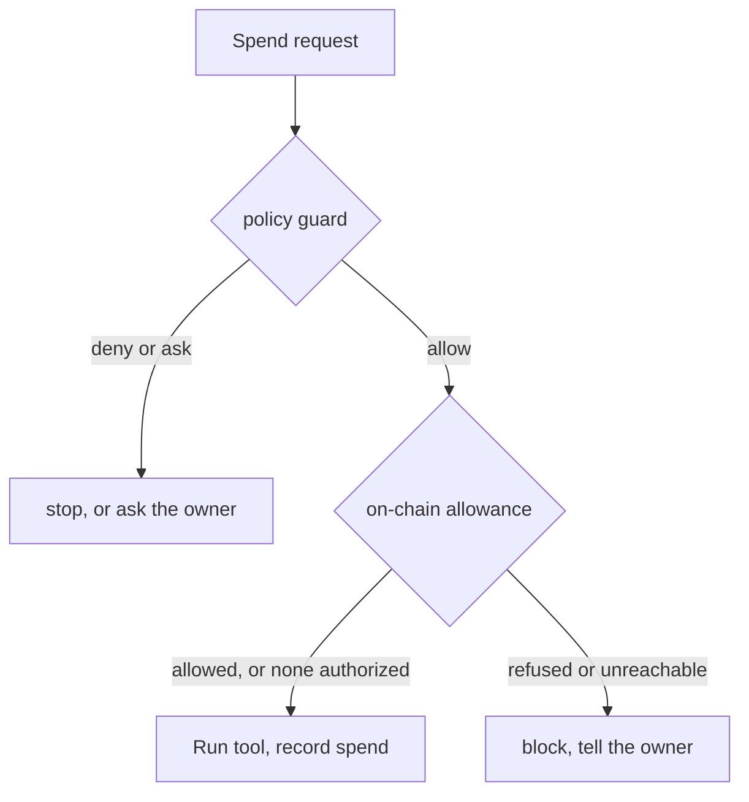

# Midnight private agent

Open Instinct normally keeps the owner's memory as plain markdown the owner can
read and edit. This document describes the optional **Midnight privacy layer**:
a shielded memory vault, selective-disclosure proofs, and ZK-gated allowances,
anchored on [Midnight](https://midnight.network/).

The whole point in one sentence: **the agent's words never leave the host; the
chain only ever sees opaque 32-byte commitments.**

For the full inventory of what is private, what is public, and why, see
[PRIVACY-MODEL.md](PRIVACY-MODEL.md).

## Why this exists

A personal agent is only trustworthy if its memory stays private. Storing notes
in a cloud database means the operator can read them. Midnight lets us prove
things *about* a memory — that it exists, that it is a health note — without
revealing the memory itself. This layer wires that capability into the agent the
owner already texts.

## Privacy guarantees

| Data | Where it lives | On-ledger? |
|---|---|---|
| Memory text | `memory/MEMORY.md` on the agent host | No |
| Preimage (`sha256(text)`) | Circuit input only | No |
| Commitment (`persistentCommit(preimage, salt)`, computed in-circuit) | Midnight ledger | Yes |
| Owner binding (`persistentCommit(ownerSecret, commitment)`) | Midnight ledger | Yes |
| Category binding (`persistentCommit(category, commitment)`) | Midnight ledger | Yes |
| Disclosed category code | Midnight ledger | Yes (1–5, or 0 for existence) |
| Spend amount | Public running total | Yes (the limit is what the circuit enforces) |

- **Nothing reversible** is on-chain. `persistentCommit` mixes the preimage
  with a fresh random salt, so even a guessable memory cannot be brute-forced
  from the ledger. Without the salt and text the commitment cannot be opened.
- **Proofs are single-use.** Each attestation id is nullified on use, so one
  proof cannot be replayed as two.
- **A proof cannot claim the wrong category.** The category is bound to the
  commitment at commit time as a second hiding commitment, and `attest`
  re-checks the disclosed code against it in-circuit.
- **Plaintext never enters the prompt for anyone but the owner.** A non-owner
  can receive a category proof via the vault, never the text.

## Modes

| Mode | Network | Needs | Use |
|---|---|---|---|
| `mock` | none | nothing | Default. Deterministic offline anchoring. Demos, CI, smoke test. |
| `local` | midnight-local-dev | `MIDNIGHT_PROOF_URL` | Full proving round-trip on your machine. |
| `testnet` | Midnight testnet | `MIDNIGHT_PROOF_URL`, `MIDNIGHT_CONTRACT_ADDRESS` | Real transactions and explorer links. |

Mock anchors produce hashes of the form `mock_commit_…` so they are never
mistaken for real transactions. The agent boots in `mock` whenever
`MIDNIGHT_MODE` is unset, and the whole layer is **off** unless `MIDNIGHT_MODE`
(or a contract address) is present — so enabling it can never break a normal
boot.

## Architecture



The `MidnightClient` is the only component that talks to the proof server. The
agent process never holds a seed phrase; the proof server owns the wallet. This
is deliberate: an agent that gets prompt-injected cannot move funds, because it
cannot sign.

### Commit and prove flow

```mermaid
sequenceDiagram
  participant O as Owner (iMessage)
  participant A as Agent runtime
  participant M as MidnightClient
  participant P as Proof server
  participant L as Midnight ledger
  O->>A: remember privately I take medication X
  A->>A: memory_write-equivalent saves plaintext locally
  A->>M: vault_commit(text, health)
  Note over M,L: the circuit computes persistentCommit; only it can open it
  M->>P: POST /commit { preimage, salt, category }
  P->>L: commit(preimage, salt, category) -> commitment + owner and category bindings
  L-->>P: txHash
  P-->>M: { commitment, txHash }
  A-->>O: Saved privately as a health memory. Commitment 0x… tx 0x…
  O->>A: prove to my partner I have a health note, hide the name
  A->>M: vault_prove_reveal(commitment, health)
  M->>P: POST /attest { commitment, attestationId, category=1 }
  P->>L: attest(...); nullifier[attestationId]=true
  L-->>P: txHash
  A-->>O: Proof recorded. Verifier learns: health. Text stays local.
```

### Allowance gating

An allowance is a second, on-chain ceiling under the policy table. When a host
configures the registry, the runtime checks it **after** the policy allows a
gated capability and **before** the tool runs:



- Gated capabilities: `purchase`, `travel.book`, `computer.use`, `apps.use`,
  `network.ask`, declared as `ALLOWANCE_GATED_CAPABILITIES` in
  `packages/core/src/policy.ts`.
- The allowance can only narrow what the policy allowed, never widen it.
- With no allowance authorized for the triple, the JSON policy stays in charge,
  so switching the gate on does not lock the owner out.
- A check that cannot reach the ledger blocks the call. Failing closed is the
  only safe direction.
- The gate reads, it does not spend: `MidnightClient.checkAllowance()` replays
  the registry's public `limits`, `spent` and `active` maps. Recording a spend
  stays with `allowance_check` / `checkSpend()`.

The registry key is `sha256("allowance|" + owner + "|" + spender + "|" + capability)`,
lower-cased. The runtime uses the configured owner name as `owner` and the
requesting principal's id as `spender` (`owner`, or `contact:sam`), so the owner
authorizes exactly the triple they mean to cap. `npm run address`-style tooling
aside, the key is whatever `allowanceKey()` returns for that triple.

## The proof-server adapter

The agent talks to a small REST service that owns the wallet and runs the
Compact artifacts; the agent process never holds a seed phrase. It is
implemented in `deploy/midnight-devnet/src/adapter.ts` on top of the official
Midnight.js SDK, and it backs the runtime client against a real chain.

| Endpoint | Body | Returns |
|---|---|---|
| `POST /deploy` | `{ contract: "memory-vault" \| "allowance-registry" }` | `{ address, txHash }` |
| `POST /commit` | `{ contract, preimage, salt, category }` | `{ commitment, txHash }` |
| `POST /attest` | `{ contract, commitment, attestationId, category }` | `{ txHash }` |
| `POST /allowance/authorize` | `{ contract, key, maxAmount }` | `{ txHash }` |
| `POST /allowance/spend` | `{ contract, key, amount }` | `{ txHash }` |
| `POST /allowance/revoke` | `{ contract, key }` | `{ txHash }` |
| `POST /allowance/check` | `{ contract, key }` | `{ active, limitCents, spentCents }` (read-only) |
| `POST /verify` | `{ attestationId }` | `{ valid, disclosed, singleUse }` |
| `GET /verify/<attestationId>` | — | `{ valid, disclosed, singleUse }` |

`POST /commit`, `POST /attest` and the allowance calls are the only writes;
everything else, `/verify` included, is a read. The adapter funds its own DUST
on startup (`src/dust.ts`) so a freshly synced wallet can pay for the
transactions it submits instead of hanging on a fee it cannot cover.

A local reference implementation backs these with `midnight-local-dev` for
development; a testnet implementation uses a funded wallet. Both are described
in `contracts/README.md`.

`category` is the small code the circuit binds to the commitment at commit time
(`1`–`5`); `attest` only verifies when the code it is given reproduces that
binding. The adapter listens on `127.0.0.1:6400` and only accepts same-origin
JSON `POST`s, because every write submits a real transaction from its wallet.

## Agent tools

| Tool | Capability | What it does |
|---|---|---|
| `vault_commit` | `memory.write` | Save a durable memory locally and anchor its commitment |
| `vault_prove_reveal` | `memory.write` | Selective-disclosure proof: category or bare existence |
| `vault_status` | `memory.write` | Mode, contract addresses, anchor counts |
| `allowance_check` | `purchase` | ZK-gated spend against an allowance (stretch) |

Capabilities are checked by the existing policy engine, so tiers keep working
unchanged: a stranger never sees these tools, a partner cannot commit, and only
the owner speaks for the vault.

## Running it

```sh
# Offline, no wallet, always works:
pnpm --filter @open-instinct/midnight run build
node packages/midnight/scripts/prove-local.mjs

# Local config:
export MIDNIGHT_MODE=mock          # or local / testnet
export MIDNIGHT_PROOF_URL=...      # local + testnet
export MIDNIGHT_CONTRACT_ADDRESS=0x...
export MIDNIGHT_EXPLORER_URL=https://explorer.midnight.network
export MIDNIGHT_VERIFY_URL=https://your-handle.inkboxwire.com   # the agent's own public verifier

instinct midnight init             # seed the vault key
instinct midnight status           # mode, contracts, counts
instinct midnight list             # commitments so far
instinct midnight prove 0x… --disclose health
```

## Real deployment on Midnight

The agent's `mock` mode is for demos; the contracts themselves run on a real
network. `deploy/midnight-devnet/` is a self-contained project that boots a
local Midnight network (node, indexer, proof server) in Docker and deploys both
contracts to it for real:

```sh
cd deploy/midnight-devnet
npm install
npm run setup        # docker up + compile + deploy + commit + attest
npm run test:e2e     # reconnects and reads the on-chain ledger
```

A verified run produced (see `deployment.json`):

| Step | Evidence |
|---|---|
| Deploy `memory-vault` | address `cd33b0e1…b78505`, tx `00cfdfb0…f9b922c7` |
| `commit` a memory | tx `00f80e2d…0ac6d632ba5d`, commitment `47214035…b07e630c` |
| `attest` (category health) | tx `0071ed9d…415a70be4c` |
| On-chain state | 1 commitment, 1 attestation, 1 nullifier |
| Deploy `allowance-registry` | address `2d116032…2244c156` |

To move to Preprod (now Blockfrost-only, since the Midnight-hosted endpoints
retired on 2026-10-09), set `BLOCKFROST_PROJECT_ID`, run `npm run address` to
get a wallet to fund from the faucet, then run
`npm run setup -- --network preprod`. Optionally set
`MIDNIGHT_WALLET_MNEMONIC` to reuse a wallet you already funded; see
`deploy/midnight-devnet/README.md`.

### The agent drives the live chain

`npm run adapter` in `deploy/midnight-devnet/` starts the REST service above,
backed by the deployed contracts and the real wallet. Point the agent at it and
its own `MidnightClient` issues real transactions:

```sh
cd deploy/midnight-devnet && npm run adapter &   # listens on :6400
cd ../..
MIDNIGHT_PROOF_URL=http://127.0.0.1:6400 \
MIDNIGHT_CONTRACT_ADDRESS=$(node -e "console.log(require('./deploy/midnight-devnet/deployment.json').memoryVault.address)") \
node packages/midnight/scripts/adapter-roundtrip.mjs
```

A verified run drove the agent's client through the adapter and produced real
commit and attest transactions on-chain (`00092056…` and `00188329…`), with the
indexer confirming the commitment and nullifier.

## Verifying a proof

Anyone can check a proof without the agent, the wallet or the seed phrase. The
ledger is the source of truth: an attestation is recorded when the proof lands,
and a nullifier is recorded when it is spent, so verifying is a read.

```sh
# A third party points at the adapter and asks about one attestation:
instinct midnight verify <attestationId>
#   Verified — valid health proof (single-use, cannot be replayed)
#     disclosed: health (code 1)
#     single-use: yes (cannot be replayed)
#     public URL: http://127.0.0.1:6400/verify/<attestationId>

# Ask a stricter question — does it prove *this* category?
instinct midnight verify <attestationId> --expect health    # exit 0
instinct midnight verify <attestationId> --expect finance   # exit 1, mismatch
```

What this buys you:

- **No trust in the agent.** `verify()` reads the chain, not the agent's word.
- **Selective disclosure is what the ledger says.** Only the disclosed category
  comes back; the plaintext never leaves the owner's machine.
- **Single use.** A spent attestation has a nullifier, and `singleUse` reports it.
- **Challenge binding.** A verifier can hand the prover a
  `prove --challenge <64hex>`, so the proof answers that challenge and cannot be
  replayed for another one.

The same check is a plain HTTP call (`GET /verify/<id>`), so a relying party can
integrate it without our code.

### The agent's own verifier

The agent serves that same read at `GET /verify/<attestationId>`, and it is the one
route its public tunnel exposes besides `/health` and the Inkbox webhook — a proof is
public by construction, so a verifier link is safe to hand a stranger, while `/chat`,
`/status` and `/midnight/status` stay behind the token and answer `404` on the tunnel
listener. A browser gets a page (what the id proves, which single category it
disclosed, that it is single-use, and the mode it ran in); anything else gets JSON.
An id that was never anchored answers `valid: false`, and an id that is not 64 hex
is a `404` before the ledger is even consulted.

`GET /verify` is the front door: one text box, prefilled with the newest attestation
this agent issued, so a reader always has something real to check. `GET /verify?id=<64 hex>`
hands off to the proof page, which is how a reply, a slide or a bookmark can carry a
pre-filled link.

Set `MIDNIGHT_VERIFY_URL` to the agent's public base URL (its tunnel host) and every
proof reply carries `…/verify/<attestation id>`, so the person on the other end can
check the proof in a browser without the CLI. With it unset, replies quote the bare
id as before.

To inspect a proof by hand:

1. `instinct midnight list` shows each commitment with its category and tx hash.
2. Open the tx in the explorer (`MIDNIGHT_EXPLORER_URL`).
3. Confirm the ledger holds a 32-byte commitment and a category code — and no
   text. Recompute the commitment locally from the memory to confirm the
   binding.

## Demo script (what to show a judge)

1. Text the agent: *"remember privately that I take medication X daily."*
   → *"Saved privately as a health memory. Commitment 0x… anchored (tx 0x…)."*
2. *"what do you remember?"* (as the owner) → full recall from `MEMORY.md`.
3. *"prove to my partner I have a health note, but don't reveal it."*
   → selective-disclosure proof + tx. Verifier learns `health`, nothing else.
4. The partner runs `instinct midnight verify <attestationId> --expect health`
   → `Verified`, exit 0. Switch to `--expect finance` → `Mismatch`, exit 1.
5. `instinct midnight list` → the commitment row, no plaintext.
6. Open the tx in the explorer → a hash and a category code, no words.
